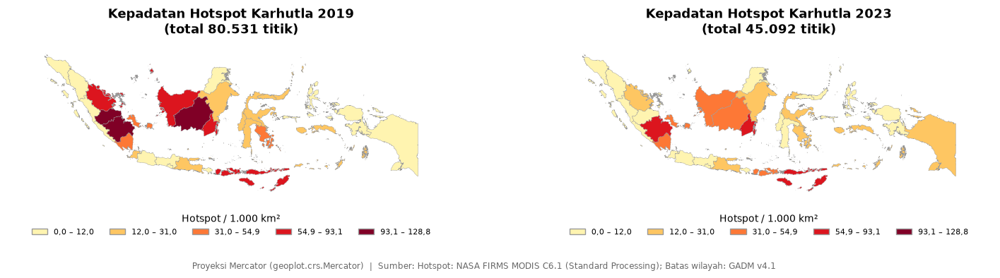
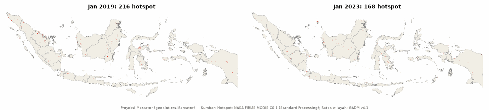

# Indonesia Fire & Poverty Map

Visualisasi data geospasial tentang **kemiskinan dan kebakaran hutan/lahan (karhutla)** di 34 provinsi Indonesia, dengan perbandingan tahun **2019 vs 2023**.



## Isi
| Teknik | Keterangan |
|---|---|
| Polyplot | Peta dasar 34 provinsi, proyeksi Mercator |
| Choropleth | Kemiskinan, kepadatan hotspot, perbandingan skema klasifikasi (Quantiles / Equal Interval / Natural Breaks), dan perubahan kemiskinan (diverging) |
| Overlay & multi-dimensi | Choropleth kemiskinan + pointplot hotspot (hue = confidence, scale = FRP) |
| KDE | Kepadatan hotspot karhutla |
| Cartogram | Penyusutan provinsi sebanding jumlah hotspot |
| Animasi | GIF hotspot bulanan 2019 vs 2023 |



## Data
| Data | Sumber |
|---|---|
| Batas provinsi | [GADM v4.1](https://gadm.org/download_country.html), Indonesia level 1 |
| Kemiskinan, IPM, penduduk, kepadatan | [Badan Pusat Statistik](https://www.bps.go.id) |
| Titik panas (hotspot) | [NASA FIRMS](https://firms.modaps.eosdis.nasa.gov/), MODIS C6.1 Standard Processing |

Semua data sudah tersedia di folder `data/`, jadi notebook bisa dijalankan tanpa API key.
Data FIRMS hanya akan diunduh ulang jika file `data/firms_modis_YYYY.csv` dihapus. Untuk itu, buat file `firms_key.txt` berisi MAP_KEY dari [FIRMS](https://firms.modaps.eosdis.nasa.gov/api/map_key/).

## Menjalankan
```bash
pip install geopandas geoplot cartopy matplotlib mapclassify imageio requests
jupyter notebook NaufalRafifHidayat_103012300403_TugasGeospasial.ipynb
```

---
Tugas Sub-CLO-12-2-2, Visualisasi Data · Naufal Rafif Hidayat
